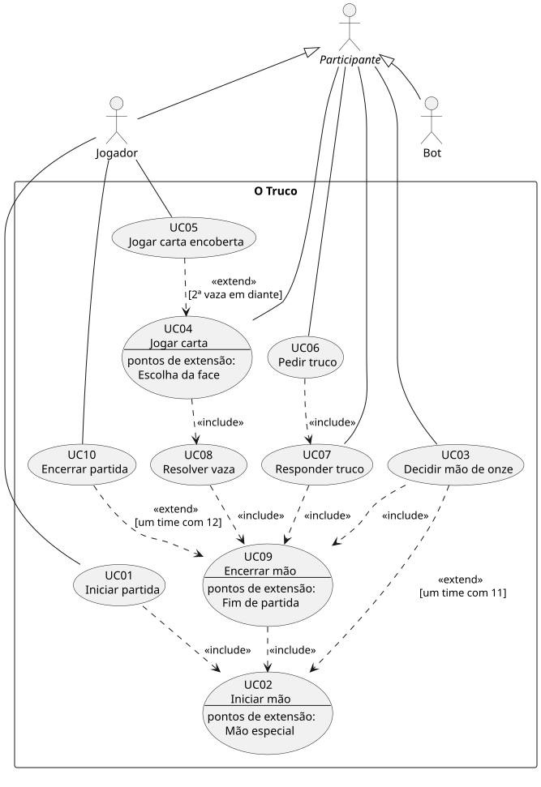

# O Truco — Especificação de Casos de Uso

Desafio 1 — Análise e Projeto de Sistemas
Jogo de Truco Paulista 2×2: 1 jogador humano e 3 bots (1 parceiro e 2 adversários).

## Sumário

1. [Glossário](#1-glossário)
2. [Regras de negócio](#2-regras-de-negócio)
3. [Regras de escopo](#3-regras-de-escopo)
4. [Atores](#4-atores)
5. [Casos de uso e relacionamentos](#5-casos-de-uso-e-relacionamentos)
6. [Especificação dos casos de uso](#6-especificação-dos-casos-de-uso)
7. [Matriz de rastreabilidade](#7-matriz-de-rastreabilidade)

---

## 1. Glossário

| Termo | Significado |
|---|---|
| Partida | Disputa completa entre os dois times, até um deles chegar a 12 pontos. |
| Mão | Rodada em que cada jogador recebe 3 cartas. Vale pontos para o time vencedor. |
| Vaza | Cada uma das (até) 3 disputas de uma mão: cada jogador joga uma carta e a maior vence. |
| Vira | Carta virada para cima após a distribuição. Define a manilha. |
| Manilha | As 4 cartas do valor seguinte ao da vira. Vencem qualquer carta comum. |
| Zap | A manilha de paus, a maior carta do jogo. |
| Distribuidor | Jogador que dá as cartas na mão. O primeiro a jogar é o jogador seguinte a ele. |
| Pedido de truco | Proposta para aumentar o valor da mão (truco, seis, nove, doze). |
| Correr | Desistir: de um pedido de truco ou da mão de onze. |
| Carta encoberta | Carta jogada virada para baixo, que perde para qualquer outra. |
| Mão de onze | Mão em que só um time tem 11 pontos. |
| Mão de ferro | Mão em que os dois times têm 11 pontos. |

## 2. Regras de negócio

- **RN01** – Baralho de 40 cartas (sem 8, 9, 10 e coringas).
- **RN02** – Ordem de força das cartas comuns, da menor para a maior: 4, 5, 6, 7, Q, J, K, A, 2, 3. Cartas comuns de mesmo valor empatam (o naipe não desempata).
- **RN03** – 4 jogadores em 2 times; parceiros sentam frente a frente; a ordem de jogo é anti-horária.
- **RN04** – Cada jogador recebe 3 cartas e depois se vira uma carta (a "vira").
- **RN05** – Manilha: o valor seguinte ao da vira, de forma cíclica (vira 3 → manilha 4). As 4 manilhas ficam acima de qualquer carta comum e se ordenam por naipe, da menor para a maior: ouros < espadas < copas < paus (zap).
- **RN06** – A mão tem até 3 vazas, e vence o time que ganhar 2. Quem ganha a vaza começa a próxima.
- **RN07** – Empates: se a 1ª vaza empata, quem ganhar a 2ª leva a mão. Se a 2ª ou a 3ª empata, leva quem ganhou a 1ª. Se a 1ª e a 2ª empatam, a 3ª decide. Se as três empatam, ninguém pontua. Numa vaza empatada, a próxima começa com quem começou a vaza empatada.
- **RN08** – A mão vale 1 ponto. Truco → 3, seis → 6, nove → 9, doze → 12.
- **RN09** – O pedido de truco é feito na vez do jogador. O time adversário pode aceitar, correr (quem pediu ganha o valor anterior) ou aumentar. Quem pediu não pode aumentar o próprio pedido.
- **RN10** – A partida vai até 12 pontos.
- **RN11** – Mão de onze: quando só um time tem 11 pontos, os jogadores desse time veem as cartas do parceiro antes de decidir. Se o time decidir jogar, a mão vale 3. Se correr, o adversário ganha 1. Ninguém pode pedir truco nessa mão.
- **RN12** – Mão de ferro: quando os dois times têm 11 pontos, todos jogam as cartas viradas para baixo, sem ver as próprias. Ninguém pode pedir truco, e quem vencer a mão vence a partida.
- **RN13** – Carta encoberta: a partir da 2ª vaza, o jogador pode jogar uma carta virada para baixo. Ela perde para qualquer carta. Na 1ª vaza não é permitido.

## 3. Regras de escopo

As regras abaixo não são regras do truco. Elas definem o escopo desta implementação e fecham pontos que as RN deixam em aberto.

- **RE01** – Composição: a partida tem 1 Jogador humano e 3 Bots. O parceiro do Jogador é um Bot, e os dois adversários são Bots.
- **RE02** – Distribuidor: na 1ª mão da partida o distribuidor é sorteado. A cada nova mão, o papel passa ao jogador seguinte no sentido anti-horário. O primeiro a jogar em cada mão é o jogador seguinte ao distribuidor.
- **RE03** – Resposta pelo time: quando o time do Jogador recebe um pedido de truco, quem responde é o Jogador. Quando o time dos Bots recebe um pedido, responde o primeiro Bot adversário na ordem de jogo depois de quem pediu.
- **RE04** – Próximo pedido: depois que um pedido é aceito, só o time que aceitou pode fazer o próximo pedido de aumento da mão (interpretação de RN09).
- **RE05** – Comportamento dos Bots: o Bot joga uma carta aleatória da mão; pede truco aleatoriamente quando a regra permite; ao responder um pedido, escolhe aleatoriamente uma das opções permitidas (aceitar, correr ou aumentar); na mão de onze do seu time, decide aleatoriamente entre jogar e correr; nunca joga carta encoberta. Toda ação do Bot acontece após um pequeno intervalo, para que o Jogador possa acompanhar.
- **RE06** – Visibilidade: as cartas do Jogador ficam viradas para cima e as dos Bots, viradas para baixo. Exceções: na mão de onze do time do Jogador, as cartas do parceiro ficam viradas para cima enquanto o Jogador decide (RN11); na mão de ferro, as cartas de todos ficam viradas para baixo (RN12).
- **RE07** – Empate entre parceiros: se a maior carta de uma vaza aparece em mais de um jogador, mas todos do mesmo time, esse time vence a vaza. A próxima vaza começa com o primeiro desses jogadores a ter jogado.
- **RE08** – Na mão de ferro não se joga carta encoberta, pois todas as cartas já estão viradas para baixo.

## 4. Atores

| Ator | Tipo | Descrição |
|---|---|---|
| *Participante* | Abstrato | Qualquer jogador sentado à mesa. Reúne o que é comum ao Jogador e ao Bot: jogar carta, pedir e responder truco e decidir a mão de onze. |
| Jogador | Primário, humano | A pessoa que usa o jogo. Inicia a partida e é o único que pode jogar carta encoberta. |
| Bot | Primário, simulado | Jogador controlado pelo computador (RE05). Ocupa três lugares à mesa: o parceiro do Jogador e os dois adversários. |

**Por que o Bot é um ator.** Em rigor, um ator é externo ao sistema, e o Bot é implementado dentro do jogo. Ele foi modelado como ator porque ocupa o **papel** de jogador: as interações dele com a mesa são as mesmas de um humano, e numa versão multiplayer esse papel seria exercido por outra pessoa. A generalização *Participante* → Jogador / Bot evita repetir as mesmas associações para os dois atores.

**Casos de uso sem ator.** UC02, UC08 e UC09 descrevem comportamento do próprio sistema, reutilizado por outros casos de uso por meio de `<<include>>`. Eles não são iniciados diretamente por nenhum ator.

## 5. Casos de uso e relacionamentos

| ID | Caso de uso | Ator | Resumo |
|---|---|---|---|
| UC01 | Iniciar partida | Jogador | Monta os times, zera o placar e começa a primeira mão. |
| UC02 | Iniciar mão | — | Embaralha, distribui, vira a vira e define a manilha. |
| UC03 | Decidir mão de onze | Participante | O time com 11 pontos decide entre jogar e correr. |
| UC04 | Jogar carta | Participante | O jogador da vez coloca uma carta na mesa. |
| UC05 | Jogar carta encoberta | Jogador | O Jogador joga uma carta virada para baixo. |
| UC06 | Pedir truco | Participante | Pede para aumentar o valor da mão. |
| UC07 | Responder truco | Participante | Aceita, corre ou aumenta um pedido de truco. |
| UC08 | Resolver vaza | — | Define o vencedor da vaza e se a mão está decidida. |
| UC09 | Encerrar mão | — | Soma os pontos e prepara a próxima mão. |
| UC10 | Encerrar partida | Jogador | Declara o vencedor e oferece uma nova partida. |

### Relacionamentos

`<<include>>`: o caso base sempre executa o caso incluído quando o seu fluxo chega ao passo onde a inclusão está. A seta vai do base para o incluído.
`<<extend>>`: o caso de extensão acrescenta comportamento opcional ao caso base, num ponto de extensão, somente se a condição for verdadeira. O caso base faz sentido sem a extensão. A seta vai da extensão para o base.

| Relação | Tipo | Condição / Justificativa |
|---|---|---|
| UC01 → UC02 | `<<include>>` | Toda partida começa com uma mão. |
| UC09 → UC02 | `<<include>>` | Se a partida continua, toda mão encerrada é seguida de outra. |
| UC03 → UC02 | `<<extend>>` | Ponto *Mão especial*: só quando exatamente um time tem 11 pontos (RN11). |
| UC05 → UC04 | `<<extend>>` | Ponto *Escolha da face*: só para o Jogador, a partir da 2ª vaza e fora da mão de ferro (RN13, RE08). |
| UC04 → UC08 | `<<include>>` | Quando a 4ª carta da vaza é jogada, a vaza sempre é resolvida. |
| UC06 → UC07 | `<<include>>` | Um pedido de truco sempre exige resposta do time adversário. |
| UC07 → UC09 | `<<include>>` | Quando o time corre, a mão termina. |
| UC03 → UC09 | `<<include>>` | Quando o time com 11 corre, a mão termina sem vazas. |
| UC08 → UC09 | `<<include>>` | Quando a mão fica decidida pelas vazas, ela termina. |
| UC10 → UC09 | `<<extend>>` | Ponto *Fim de partida*: só quando um time chega a 12 pontos (RN10, RN12). |
| Jogador, Bot → Participante | Generalização | Jogador e Bot exercem o papel de participante da mesa. |

A mão de ferro (RN12) não é um caso de uso próprio: ninguém tem como objetivo "jogar a mão de ferro"; ela é uma condição da mão. Por isso aparece como fluxo alternativo em UC02 e UC04 e como restrição em UC05 e UC06.

### Diagrama

Fonte do diagrama: [diagrama-casos-de-uso.puml](diagrama-casos-de-uso.puml) (PlantUML).

## 6. Especificação dos casos de uso

### UC01 – Iniciar partida

**Atores:** Jogador
**Descrição:** o Jogador inicia uma nova partida de truco contra os Bots.

**Pré-condições**
- O jogo está aberto.
- Não há partida em andamento.

**Fluxo principal**
1. O Jogador solicita uma nova partida.
2. O sistema forma os dois times: o Jogador e um Bot parceiro, sentados frente a frente, contra dois Bots adversários (RN03, RE01).
3. O sistema zera o placar dos dois times (RN10).
4. O sistema sorteia o distribuidor da primeira mão (RE02).
5. O sistema inclui **UC02 – Iniciar mão**.
6. O caso de uso termina.

**Fluxos alternativos**
- **FA01 – Nova partida após o fim de outra** (passo 1): ao fim de UC10, o Jogador escolhe jogar novamente. O sistema descarta o estado da partida anterior e segue do passo 2.

**Fluxos de exceção**
- Não há.

**Pós-condições**
- Há uma partida em andamento, com placar 0 × 0.
- A primeira mão foi iniciada.

**Regras:** RN03, RN10; RE01, RE02

---

### UC02 – Iniciar mão

**Atores:** — (comportamento do sistema; incluído por UC01 e UC09)
**Descrição:** o sistema prepara uma nova mão: embaralha, distribui as cartas, vira a vira e define a manilha.

**Pré-condições**
- Há uma partida em andamento.
- Não há mão em andamento.
- O distribuidor da mão está definido.

**Fluxo principal**
1. O sistema monta o baralho de 40 cartas (RN01) e o embaralha.
2. O sistema distribui 3 cartas para cada jogador (RN04).
3. O sistema vira a carta seguinte do baralho como vira (RN04) e determina a manilha: o valor seguinte ao da vira, de forma cíclica (RN05).
4. O sistema define o valor da mão como 1 ponto (RN08).
5. O sistema mostra a vira, as cartas do Jogador viradas para cima e as cartas dos Bots viradas para baixo (RE06).
6. O sistema verifica a pontuação dos times. *(ponto de extensão: **Mão especial**)*
7. O sistema define como primeiro a jogar o jogador seguinte ao distribuidor no sentido anti-horário (RN03, RE02) e abre a 1ª vaza.
8. O caso de uso termina, e o primeiro jogador inicia **UC04 – Jogar carta**.

**Fluxos alternativos**
- **FA01 – Mão de onze** (passo 6): se exatamente um time tem 11 pontos, **UC03 – Decidir mão de onze** estende este caso. Se o time decidir jogar, segue o passo 7. Se o time correr, a mão é encerrada em UC03 e este caso termina.
- **FA02 – Mão de ferro** (passo 6): se os dois times têm 11 pontos, o sistema vira para baixo as cartas de todos os jogadores, inclusive as do Jogador, e impede pedidos de truco e cartas encobertas nesta mão (RN12, RE08). Segue o passo 7.

**Fluxos de exceção**
- Não há.

**Pós-condições**
- Cada jogador tem 3 cartas; a vira, a manilha e o valor da mão estão definidos.
- A 1ª vaza está aberta, ou a mão foi encerrada porque o time com 11 pontos correu (UC03).

**Regras:** RN01, RN03, RN04, RN05, RN08, RN11, RN12; RE02, RE06, RE08

---

### UC03 – Decidir mão de onze

**Atores:** Participante (Jogador ou Bot) do time que tem 11 pontos
**Descrição:** quando só um time tem 11 pontos, esse time vê as cartas do parceiro e decide se joga a mão ou corre.
**Extensão:** estende UC02 no ponto *Mão especial*, quando exatamente um time tem 11 pontos (RN11).

**Pré-condições**
- As cartas da mão foram distribuídas (UC02, passos 1 a 5).
- Exatamente um time tem 11 pontos.

**Fluxo principal** *(o time do Jogador tem 11 pontos)*
1. O sistema anuncia a mão de onze.
2. O sistema mostra ao Jogador as cartas do seu parceiro, viradas para cima (RN11, RE06).
3. O sistema pede ao Jogador que decida entre jogar e correr.
4. O Jogador escolhe jogar.
5. O sistema define o valor da mão como 3 pontos e impede pedidos de truco nesta mão (RN11).
6. O sistema volta a virar para baixo as cartas do parceiro (RE06).
7. O caso de uso termina, e UC02 continua no passo 7.

**Fluxos alternativos**
- **FA01 – O time dos Bots tem 11 pontos** (passo 2): as cartas dos Bots não são mostradas ao Jogador. Após um pequeno intervalo, o Bot decide aleatoriamente entre jogar e correr (RE05). Se decidir jogar, segue o passo 5.
- **FA02 – Correr** (passo 4 ou FA01): o time com 11 pontos corre. O sistema registra que o time adversário ganha 1 ponto (RN11), volta a virar para baixo as cartas que estavam visíveis e inclui **UC09 – Encerrar mão**, sem que nenhuma vaza seja jogada.

**Fluxos de exceção**
- **FE01 – Ação antes da decisão** (passos 1 a 4): enquanto a decisão não é tomada, o sistema ignora tentativas de jogar carta ou pedir truco.

**Pós-condições**
- O time decidiu jogar: a mão vale 3 pontos e não admite pedidos de truco; ou
- O time correu: a mão foi encerrada e o adversário ganhou 1 ponto.

**Regras:** RN11; RE05, RE06

---

### UC04 – Jogar carta

**Atores:** Participante (Jogador ou Bot)
**Descrição:** o participante da vez coloca uma de suas cartas na mesa, na vaza atual.

**Pré-condições**
- Há uma mão em andamento, com uma vaza aberta.
- É a vez do participante.
- O participante tem pelo menos uma carta na mão.
- Não há pedido de truco esperando resposta (UC07) nem decisão de mão de onze pendente (UC03).

**Fluxo principal**
1. O sistema indica de quem é a vez e, se for o Jogador, habilita as cartas dele.
2. O participante escolhe uma carta da mão. *(ponto de extensão: **Escolha da face**)*
3. O sistema retira a carta da mão do participante e a coloca na mesa, virada para cima, diante dele.
4. O sistema passa a vez ao próximo jogador, no sentido anti-horário (RN03).
5. O caso de uso termina.

**Fluxos alternativos**
- **FA01 – Última carta da vaza** (passo 4): se a carta jogada foi a 4ª da vaza, o sistema não passa a vez e inclui **UC08 – Resolver vaza**.
- **FA02 – Pedido de truco antes de jogar** (passo 2): na sua vez, antes de escolher a carta, o participante pode pedir truco (**UC06**). Se o pedido for aceito, segue o passo 2. Se o adversário correr, a mão termina e este caso também.
- **FA03 – Jogada do Bot** (passo 2): após um pequeno intervalo, o Bot pode pedir truco (FA02). Depois, escolhe uma carta aleatória da mão (RE05) e segue o passo 3.
- **FA04 – Mão de ferro** (passo 2): as cartas do participante estão viradas para baixo, e ele escolhe uma sem saber qual é. No passo 3, a carta é revelada ao ir para a mesa (RN12).

**Ponto de extensão**
- **Escolha da face** (passo 2): **UC05 – Jogar carta encoberta**, quando o participante é o Jogador, a vaza atual é a 2ª ou a 3ª e a mão não é de ferro (RN13, RE08).

**Fluxos de exceção**
- **FE01 – Fora da vez** (passo 2): o Jogador tenta jogar uma carta quando não é a vez dele. O sistema ignora a ação e nada muda.
- **FE02 – Decisão pendente** (passo 2): o Jogador tenta jogar enquanto um pedido de truco espera resposta ou a mão de onze não foi decidida. O sistema ignora a ação até a pendência ser resolvida.

**Pós-condições**
- A carta está na mesa, na vaza atual, e saiu da mão do participante.
- A vez passou ao próximo jogador, ou a vaza foi resolvida (UC08).

**Regras:** RN03, RN09, RN12, RN13; RE05, RE08

---

### UC05 – Jogar carta encoberta

**Atores:** Jogador
**Descrição:** o Jogador joga uma carta virada para baixo, que perde para qualquer outra carta da vaza.
**Extensão:** estende UC04 no ponto *Escolha da face*, quando o participante é o Jogador, a vaza atual é a 2ª ou a 3ª (RN13) e a mão não é de ferro (RE08). Os Bots nunca jogam carta encoberta (RE05).

**Pré-condições**
- É a vez do Jogador em UC04.
- A vaza atual é a 2ª ou a 3ª.
- A mão não é de ferro.

**Fluxo principal**
1. O Jogador indica que quer jogar a próxima carta encoberta.
2. O Jogador escolhe uma carta da mão.
3. O sistema retira a carta da mão do Jogador e a coloca na mesa virada para baixo, sem revelá-la aos outros jogadores.
4. O sistema registra a carta como encoberta: na resolução da vaza, ela perde para qualquer outra carta (RN13).
5. O caso de uso termina, e UC04 continua no passo 4.

**Fluxos alternativos**
- **FA01 – Desistir de jogar encoberta** (passo 2): antes de escolher a carta, o Jogador desfaz a indicação. UC04 continua no passo 2, com a carta sendo jogada virada para cima.

**Fluxos de exceção**
- **FE01 – Primeira vaza** (passo 1): na 1ª vaza, a opção de jogar encoberta não está disponível (RN13).
- **FE02 – Mão de ferro** (passo 1): na mão de ferro, a opção de jogar encoberta não está disponível (RE08).

**Pós-condições**
- A carta está na mesa, virada para baixo, marcada como encoberta.

**Regras:** RN13; RE05, RE08

---

### UC06 – Pedir truco

**Atores:** Participante (Jogador ou Bot)
**Descrição:** na sua vez, o participante pede para aumentar o valor da mão; o time adversário precisa responder.

**Pré-condições**
- Há uma mão em andamento, é a vez do participante e ele ainda não jogou carta nesta vez (RN09).
- A mão não é de onze nem de ferro (RN11, RN12).
- O valor atual da mão é menor que 12 (RN08).
- Não há pedido de truco esperando resposta.
- O time do participante não foi o autor do último pedido aceito (RE04).

**Fluxo principal**
1. O participante pede truco.
2. O sistema determina o valor pedido, o próximo da sequência 1 → 3 → 6 → 9 → 12 (RN08), e o anuncia ("Truco!", "Seis!", "Nove!" ou "Doze!").
3. O sistema registra o pedido como pendente e suspende as jogadas.
4. O sistema inclui **UC07 – Responder truco**, para o time adversário.
5. O pedido foi aceito: a vez continua com o participante, que joga uma carta (UC04).
6. O caso de uso termina.

**Fluxos alternativos**
- **FA01 – Pedido do Bot** (passo 1): na sua vez, se as pré-condições são atendidas, o Bot decide aleatoriamente se pede truco (RE05).
- **FA02 – O adversário correu** (passo 5): a mão já foi encerrada em UC07. O caso de uso termina.

**Fluxos de exceção**
- **FE01 – Pedido não permitido** (passo 1): se alguma pré-condição não é atendida, a opção de pedir truco fica indisponível para o Jogador e o sistema ignora a tentativa.

**Pós-condições**
- O valor da mão foi atualizado (pedido aceito); ou
- A mão foi encerrada (adversário correu).

**Regras:** RN08, RN09, RN11, RN12; RE04, RE05

---

### UC07 – Responder truco

**Atores:** Participante (Jogador ou Bot) do time que recebeu o pedido (RE03)
**Descrição:** o time que recebeu um pedido de truco aceita, corre ou aumenta.

**Pré-condições**
- Há um pedido de truco pendente, feito pelo time adversário.

**Fluxo principal**
1. O sistema apresenta o pedido e as opções permitidas: aceitar, correr e, se o valor pedido for menor que 12, aumentar (RN09).
2. O participante aceita.
3. O sistema define o valor da mão como o valor pedido (RN08) e registra o time que aceitou como o único que pode fazer o próximo pedido (RE04).
4. O sistema retira o pedido pendente e libera as jogadas.
5. O caso de uso termina.

**Fluxos alternativos**
- **FA01 – Correr** (passo 2): o participante corre. O time que fez o pedido ganha o valor anterior ao pedido pendente (RN09): truco → 1, seis → 3, nove → 6, doze → 9. O sistema inclui **UC09 – Encerrar mão**.
- **FA02 – Aumentar** (passo 2): o participante aumenta. O sistema registra um novo pedido pendente, com o valor seguinte da sequência (RN08), agora feito pelo time do participante. O time que tinha pedido passa a responder, e o fluxo volta ao passo 1 com os papéis invertidos. O time que fez o novo pedido não pode aumentá-lo (RN09).
- **FA03 – Resposta do Bot** (passo 2): se o time que responde é o dos Bots, após um pequeno intervalo o Bot escolhe aleatoriamente uma das opções permitidas (RE05).

**Fluxos de exceção**
- **FE01 – Ação durante o pedido** (passos 1 e 2): enquanto o pedido está pendente, o sistema ignora tentativas de jogar carta ou de fazer outro pedido.

**Pós-condições**
- O pedido foi aceito e o valor da mão, atualizado; ou
- O time correu e a mão foi encerrada; ou
- Há um novo pedido pendente, feito pelo time que aumentou.

**Regras:** RN08, RN09; RE03, RE04, RE05

---

### UC08 – Resolver vaza

**Atores:** — (comportamento do sistema; incluído por UC04)
**Descrição:** o sistema compara as cartas da vaza, define o vencedor e verifica se a mão está decidida.

**Pré-condições**
- As 4 cartas da vaza foram jogadas.

**Fluxo principal**
1. O sistema compara as cartas da vaza, nesta ordem de critérios:
   - carta encoberta perde para qualquer outra (RN13);
   - manilha vence qualquer carta comum, e as manilhas se ordenam por naipe: ouros < espadas < copas < paus (RN05);
   - cartas comuns seguem a ordem 4 < 5 < 6 < 7 < Q < J < K < A < 2 < 3 (RN02).
2. O sistema identifica a maior carta. Se apenas um jogador a tem, o time desse jogador vence a vaza.
3. O sistema mostra o vencedor da vaza e registra o resultado.
4. O sistema verifica se a mão está decidida, conforme a tabela abaixo (RN06, RN07).
5. A mão não está decidida: o sistema recolhe as cartas da mesa e abre a próxima vaza, começando por quem venceu esta (RN06). O jogador que começa inicia UC04.
6. O caso de uso termina.

**Tabela de decisão da mão (passo 4)**

| Resultado das vazas até aqui | Mão decidida? | Vencedor |
|---|---|---|
| Um time venceu 2 vazas | Sim | Esse time |
| 1ª empatada; 2ª com vencedor | Sim | Vencedor da 2ª |
| 1ª com vencedor; 2ª empatada | Sim | Vencedor da 1ª |
| 1ª e 2ª com vencedores diferentes; 3ª empatada | Sim | Vencedor da 1ª |
| 1ª e 2ª empatadas; 3ª com vencedor | Sim | Vencedor da 3ª |
| As 3 vazas empatadas | Sim | Ninguém |
| 1ª e 2ª com vencedores diferentes | Não | A 3ª decide |
| 1ª e 2ª empatadas | Não | A 3ª decide |
| Apenas a 1ª jogada (com vencedor ou empatada) | Não | — |

**Fluxos alternativos**
- **FA01 – Vaza empatada** (passo 2): se a maior carta aparece em jogadores de times diferentes (só é possível com cartas comuns de mesmo valor, RN02), a vaza empata. A próxima vaza começa com quem começou a vaza empatada (RN07).
- **FA02 – Maior carta repetida no mesmo time** (passo 2): se a maior carta aparece em mais de um jogador, mas todos do mesmo time, esse time vence a vaza. A próxima vaza começa com o primeiro desses jogadores a ter jogado (RE07).
- **FA03 – Mão decidida** (passo 5): o sistema inclui **UC09 – Encerrar mão**, informando o time vencedor (ou que ninguém venceu, se as três vazas empataram).

**Fluxos de exceção**
- Não há.

**Pós-condições**
- O resultado da vaza está registrado.
- A próxima vaza foi aberta, ou a mão foi encerrada (UC09).

**Regras:** RN02, RN05, RN06, RN07, RN13; RE07

---

### UC09 – Encerrar mão

**Atores:** — (comportamento do sistema; incluído por UC03, UC07 e UC08)
**Descrição:** o sistema soma os pontos da mão ao vencedor, verifica o fim da partida e prepara a próxima mão.

**Pré-condições**
- A mão foi decidida por um destes motivos: um time venceu pelas vazas (UC08), um time correu de um pedido de truco (UC07), o time com 11 pontos correu (UC03) ou as três vazas empataram (UC08).

**Fluxo principal**
1. O sistema soma ao placar do time vencedor os pontos da mão, conforme o motivo do encerramento:
   - vitória pelas vazas: o valor atual da mão (RN08), que é 3 na mão de onze (RN11);
   - adversário correu de um pedido de truco: o valor anterior ao pedido (RN09);
   - time com 11 pontos correu da mão de onze: 1 ponto para o adversário (RN11).
2. O sistema mostra o resultado da mão e o placar atualizado.
3. O sistema recolhe as cartas da mesa e das mãos e encerra a mão.
4. O sistema verifica se algum time chegou a 12 pontos. *(ponto de extensão: **Fim de partida**)*
5. O sistema passa o papel de distribuidor ao próximo jogador, no sentido anti-horário (RE02), e inclui **UC02 – Iniciar mão**.
6. O caso de uso termina.

**Fluxos alternativos**
- **FA01 – Ninguém pontua** (passo 1): se as três vazas empataram, nenhum time pontua (RN07). Segue o passo 2.
- **FA02 – Fim de partida** (passo 4): se algum time tem 12 pontos ou mais (RN10), o que inclui o vencedor de uma mão de ferro (RN12), **UC10 – Encerrar partida** estende este caso, e os passos 5 e 6 não são executados.

**Fluxos de exceção**
- Não há.

**Pós-condições**
- O placar está atualizado.
- Uma nova mão foi iniciada, ou a partida foi encerrada (UC10).

**Regras:** RN07, RN08, RN09, RN10, RN11, RN12; RE02

---

### UC10 – Encerrar partida

**Atores:** Jogador
**Descrição:** o sistema declara o time vencedor da partida e oferece ao Jogador uma nova partida.
**Extensão:** estende UC09 no ponto *Fim de partida*, quando um time tem 12 pontos ou mais (RN10, RN12).

**Pré-condições**
- Um time chegou a 12 pontos ou mais.

**Fluxo principal**
1. O sistema declara o time vencedor e mostra o placar final.
2. O sistema impede novas jogadas e pedidos de truco.
3. O sistema oferece ao Jogador a opção de jogar uma nova partida.
4. O Jogador escolhe jogar novamente.
5. O sistema inicia **UC01 – Iniciar partida** (UC01, FA01).
6. O caso de uso termina.

**Fluxos alternativos**
- **FA01 – Não jogar novamente** (passo 4): o Jogador não inicia nova partida. O resultado continua na tela até o Jogador fechar o jogo.

**Fluxos de exceção**
- Não há.

**Pós-condições**
- A partida está encerrada, com o vencedor definido.

**Regras:** RN10, RN12

## 7. Matriz de rastreabilidade

| Regra | Casos de uso |
|---|---|
| RN01 | UC02 |
| RN02 | UC08 |
| RN03 | UC01, UC02, UC04 |
| RN04 | UC02 |
| RN05 | UC02, UC08 |
| RN06 | UC08 |
| RN07 | UC08, UC09 |
| RN08 | UC02, UC06, UC07, UC09 |
| RN09 | UC04, UC06, UC07, UC09 |
| RN10 | UC01, UC09, UC10 |
| RN11 | UC02, UC03, UC06, UC09 |
| RN12 | UC02, UC04, UC06, UC09, UC10 |
| RN13 | UC04, UC05, UC08 |
| RE01 | UC01 |
| RE02 | UC01, UC02, UC09 |
| RE03 | UC07 |
| RE04 | UC06, UC07 |
| RE05 | UC03, UC04, UC05, UC06, UC07 |
| RE06 | UC02, UC03 |
| RE07 | UC08 |
| RE08 | UC02, UC04, UC05 |
